# Developer guide

Start here if you will change the code. Product intent: [PRD](PRD.md). Why
things are the way they are: [`adr/`](adr/). The 5-minute non-technical view:
[OVERVIEW](OVERVIEW.md).

## Run it

```bash
make setup      # flutter pub get + AppText classes + Android keys
make run        # on a connected device
make test       # unit + widget tests
make analyze    # dart analyze --fatal-infos
make rules-test # firestore.rules on the emulator (Node + Java 17+)
make logs       # pull app.log from a device/simulator
```

Prerequisites, Firebase setup and signing: [README](../README.md).

## Shape of the system



Every phone talks to **Cloud Firestore directly** through its offline cache;
there is no backend of our own. `firestore.rules` is therefore the real
authorization layer, and the UI is a convenience on top of it.

## Layers (`lib/`)

Dependencies point down only.

| Layer | Holds | Rule |
| --- | --- | --- |
| `ui/` | Screens by audience (`admin/` split by domain like `services/`, plus `counter`, `scanner`, `auth`, `settings`), shared widgets, theme | Calls services through providers; never touches Firestore |
| `services/` | One class per business operation, grouped by domain: `scanning/`, `money/`, `people/`, `kitchen/`, `system/` | Holds the business rules; returns data and codes, never sentences |
| `data/` | `Store` (the only place that builds Firestore paths), `Backend`, access, cache warming | Knows Firestore; knows no UI |
| `domain/` | Plain value types: member, ledger, menu, settings, inventory | No Flutter, no Firebase |
| `core/` | Errors, logging, roles, meal windows, config | Shared by every layer |
| `app/` | Bootstrap, providers (Riverpod), canteen book, session | Wiring only |
| `l10n/` | `.arb` files for English, Hindi, Marathi | `make l10n` after editing |

`test/` mirrors `lib/`. Why folders are grouped this way:
[ADR 0008](adr/0008-feature-grouped-folders.md).

## Rules to know before your first change

- **Services return codes, not sentences.** Every phone words a record in its
  own language. Adding an error: [ERRORS.md](ERRORS.md).
- **One scan per member, meal and day** is decided by the server at sync time.
  Offline phones can't see each other; don't try to enforce it client-side only.
- **Paths live in `Store` only.** A collection name is added in `Col` and in
  `firestore.rules` in the same change; `make rules-test` must stay green.
- **No silent `catch`.** A deliberate fallback still logs a line; a test fails
  on a silent one. Reading logs: [LOGGING.md](LOGGING.md).
- **No hardcoded strings or limits.** Text goes in `.arb` with a translator
  note (a parity test fails on missing or untranslated keys); business values
  go in the canteen's settings document.
- **Theme through tokens**, not literals: [THEME_SPEC.md](THEME_SPEC.md).
- **Reversals, never deletes**, for scans, top-ups and refunds (audit trail).

## Typical changes

| I want to… | Touch |
| --- | --- |
| Add a business rule to scanning | `services/scanning/scan_service.dart`, its test, an `ErrorCode` + three `.arb` sentences |
| Add a new stored thing | `domain/` type, `Col` + `Store`, `firestore.rules`, rules test, backup/restore coverage |
| Add a setting | `domain/settings.dart`, `settings_service`, Settings screen, `.arb` label |
| Add a screen | `ui/<audience>/`, provider in `app/`, role gate, `.arb` text, widget test |

## Verify before you say done

`make analyze && make test && make rules-test`, then the mobile checklist
(CLAUDE.md §11.6.9) on a real phone for anything user-facing.

## Docs map

| Doc | Answers |
| --- | --- |
| [PRD](PRD.md) | What and why; business rules §5–§8, architecture §15 |
| [ADRs](adr/) | Why, and what was rejected |
| [ERRORS](ERRORS.md) / [LOGGING](LOGGING.md) | Failure handling and reading the log |
| [USER_GUIDE](USER_GUIDE.md) | What operators see |
| [THEME_SPEC](THEME_SPEC.md) | Visual system |
| [diagrams](diagrams/README.md) | How the animated diagrams are made |
