# Tiffin at a glance

For management, directors and investors. Five minutes, no code. Engineers
want the [Developer guide](DEVELOPER_GUIDE.md); daily operators want the
[User guide](USER_GUIDE.md).

## What it is

Tiffin replaces a canteen's paper ledger with a phone app. Each student or
staff member gets one permanent QR code. At meal time a phone scans it and
shows **accept or reject** at once. What a member has paid for is tracked as
**meal units** (lunch, breakfast, brunch), never as money, so the app holds no
funds and moves no payments.

## Why it matters

| Problem on paper | What Tiffin does |
| --- | --- |
| Nobody is sure who has paid or how many meals are left | Every scan checks and updates the balance, so the number is always current |
| Queues and disputes at the counter | One scan gives a big accept/reject and a plain reason for a refusal |
| Cooking and buying by guesswork | Menu plan × headcount × recipes gives a shopping list; stock falls on each scan |
| No view of margin | Confirmed top-ups against logged expenses, on demand |
| A bad signal stops service | Scanning works offline and syncs later |

## How a day works

The busiest moment, the scan, is the one built to be fastest and hardest to get wrong:

## How it is built

- **One app on every phone.** There is no server to buy, host or keep running.
- **One shared cloud database** (Google Firebase), run by the app owner. Each
  canteen is a separate, isolated area inside it, created in one tap.
- **Offline-first.** A phone keeps working without signal and catches up when
  it returns.
- **Three languages:** English, Hindi, Marathi, chosen per phone.

## Who can do what

A new phone must be **approved by an admin** before it can read or write
anything. Permissions are enforced by the database rules, not just hidden in
the app.

## Controls, and what to know

| Topic | Position |
| --- | --- |
| Money | Units only. UPI is a pay-here QR, confirmed by hand by the admin. No payment gateway, no stored value. |
| Audit trail | Scans, top-ups and refunds are reversed or flagged, never deleted. Every action is logged; failures carry a reference code. |
| Data ownership | A canteen can export a `.xlsx` report and a full `.tiffin` backup, and import a backup into a new canteen. |
| Single point of trust | All canteens share one project the app owner pays for and administers. Rules isolate canteens and are tested on the Firebase emulator. |
| Offline limits | Two offline phones can between them take a balance below the grace limit; reports show it. A second scan of one meal is dropped at sync and its unit returned. |
| Abuse protection | **App Check is not yet enabled.** It, and a guard on canteen creation, are required before any public release. |
| Cost | Firebase's free Spark plan is enough to start. Usage is shared across canteens, so it needs watching as they grow. No pricing model or projections exist in this repository. |

## Where it stands

The items under "Next" are planned, not committed. Sources: PRD §9,
[ADR 0006](adr/0006-multi-canteen-shared-project.md) "Consequences".

## Decisions already made

Each has its reasoning and the options rejected in [`adr/`](adr/).

| ADR | Decision |
| --- | --- |
| [0005](adr/0005-firebase-offline-first.md) | Firebase, offline-first; no host phone or LAN server |
| [0006](adr/0006-multi-canteen-shared-project.md) | Many canteens in one shared Firebase project |
| [0007](adr/0007-plain-traceable-errors.md) | Errors are plain-language with a traceable reference |
| [0008](adr/0008-feature-grouped-folders.md) | Source folders grouped by feature domain |
| [0001](adr/0001-runtime-theming-and-data-portability.md) | Runtime theming and data portability |

## Glossary

- **Unit:** one prepaid meal of one type. Not a currency.
- **Grace allowance:** how many units a member may go below zero, so nobody is turned away mid-week while a payment is sorted out.
- **Canteen:** one operator's isolated space; joined with a short code or QR.
- **Phone role:** what an approved phone may do: admin, counter or scanner.
